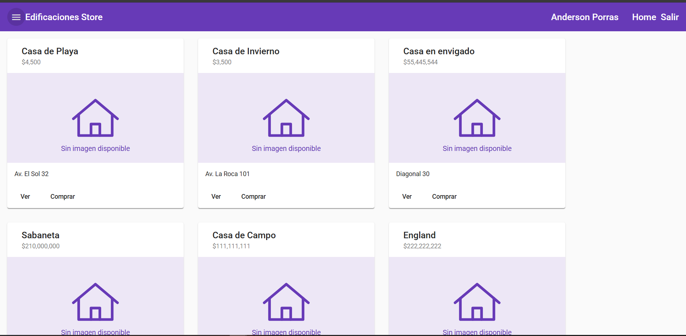
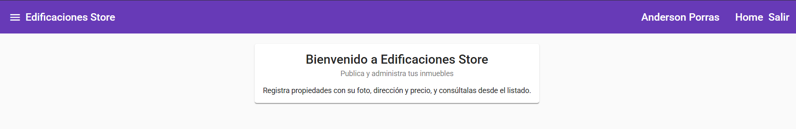

# Edificaciones Store — Angular Frontend

🇪🇸 [Leer en español](README.es.md)

A real-estate listings web app built with **Angular**. Users create an account, sign in, and publish properties (name, address, price and a photo). Photos are uploaded to **Firebase Storage**; property and user data are handled by a separate REST API.

This is a learning project. I built it to practice the patterns used in medium and large Angular apps: NgRx state management, lazy-loaded modules, route guards, HTTP interceptors and file uploads to the cloud.

## Screenshots





## Features

- **Authentication**: registration and login against the REST API. The JWT is stored and attached to every request by an HTTP interceptor.
- **Route protection**: `AuthGuard` blocks private pages for anonymous users, and `UnauthGuard` keeps signed-in users out of login and registration.
- **Properties**: list all properties and create a new one through a validated form.
- **Image upload**: a reusable upload dialog (opened by a directive) with optional image cropping, which stores files in Firebase Storage and returns the public URL. If a photo is missing or fails to load, a local placeholder image is shown.
- **UI**: Angular Material, a responsive side menu, a loading spinner, toast notifications and a 404 page.

## Tech stack

| Area | Technology |
|---|---|
| Framework | Angular 14, TypeScript |
| State management | NgRx (Store, Effects, Entity, Store DevTools) |
| UI | Angular Material, Angular Flex Layout |
| File storage | Firebase Storage (`@angular/fire`) |
| Images | ngx-image-cropper |
| Container | Docker (multi-stage build) + nginx |

## Architecture

```
src/app/
├── pages/          # Lazy-loaded feature modules
│   ├── auth/       #   login, registration
│   ├── inmueble/   #   property list and form + its own NgRx store
│   └── static/     #   welcome, 404
├── store/user/     # Global NgRx state for the session user
├── guards/         # AuthGuard / UnauthGuard
├── shared/         # Reusable modules: upload dialog, photo, spinner
├── Services/       # Notification service
├── Components/     # Header and side menu
└── auth-interceptor.ts  # Adds "Authorization: Bearer <token>"
```

Data flow: components dispatch NgRx **actions**, **effects** call the REST API, **reducers** update the store, and components read state through **selectors**.

### Backend endpoints used

| Method | Endpoint | Purpose |
|---|---|---|
| POST | `api/usuario/registrar` | Register a user |
| POST | `api/usuario/login` | Log in, returns a JWT |
| GET | `api/usuario` | Current user (restores the session) |
| GET | `api/inmueble` | List properties |
| POST | `api/inmueble` | Create a property |

The API base URL is set in `src/environments/` (default: `http://localhost:5000/`).

## Getting started

Requirements: Node.js 16 and npm.

```bash
npm install

# Firebase credentials (this file is gitignored)
cp src/environments/firebase.config.example.ts src/environments/firebase.config.ts
# then fill in the values from your Firebase project

npm start               # dev server at http://localhost:4200
npm run build:prod      # production build into dist/
```

The backend API must be running at the configured URL for login and properties to work.

## Docker

The `Dockerfile` builds the app with Node 16 and serves the static output with nginx. `nginx.conf` sends every route to `index.html` so Angular routing works on page reload.

```bash
docker build -t edificaciones-store .
docker run -p 8080:80 edificaciones-store   # http://localhost:8080
```

## What I learned

- Structuring an Angular app as lazy-loaded feature modules with their own routing.
- Managing shared state with NgRx and keeping side effects (HTTP calls) in effects instead of components.
- Securing navigation with guards and adding JWT authentication through an interceptor.
- Integrating Firebase Storage for user uploads and keeping credentials out of the repository.
- Packaging a single-page app in a Docker image with nginx.

## Roadmap

- [ ] Upgrade to the current Angular version and replace Flex Layout, which is no longer maintained, with CSS Grid/Flexbox.
- [ ] Add unit tests for the reducers, effects and guards.
- [ ] Edit and delete properties.
